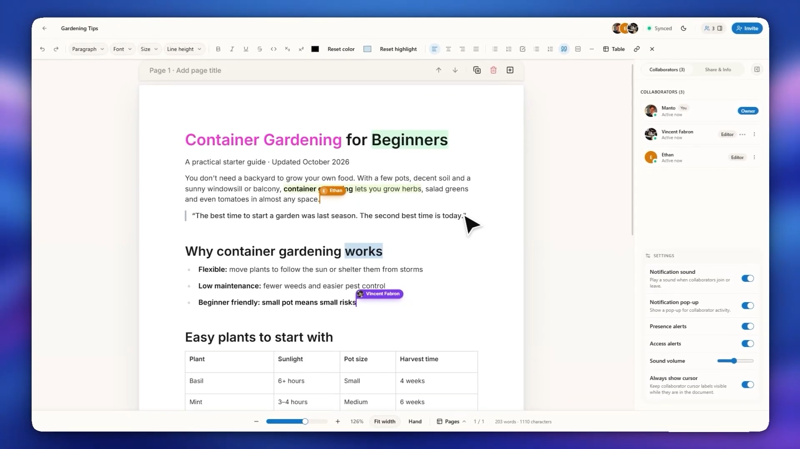
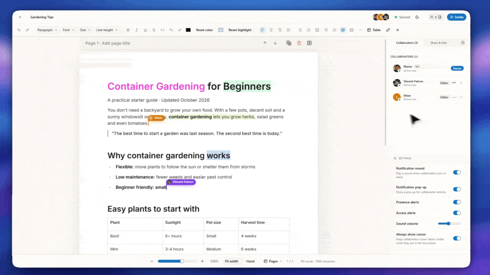
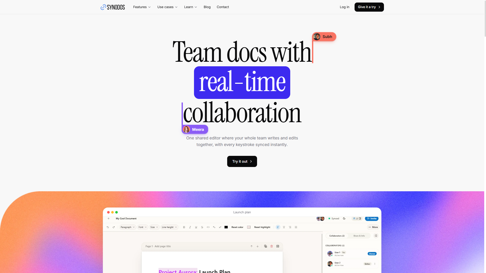
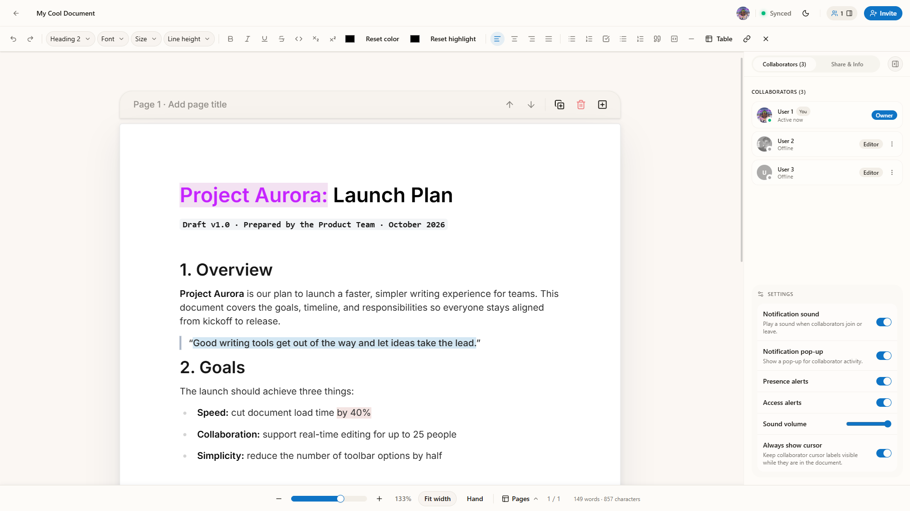
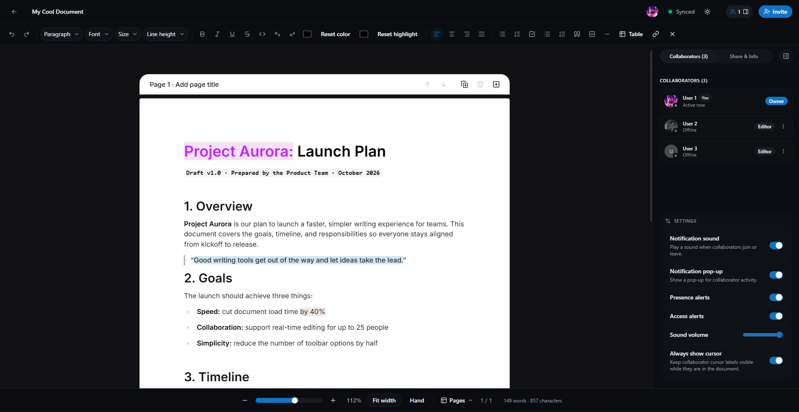
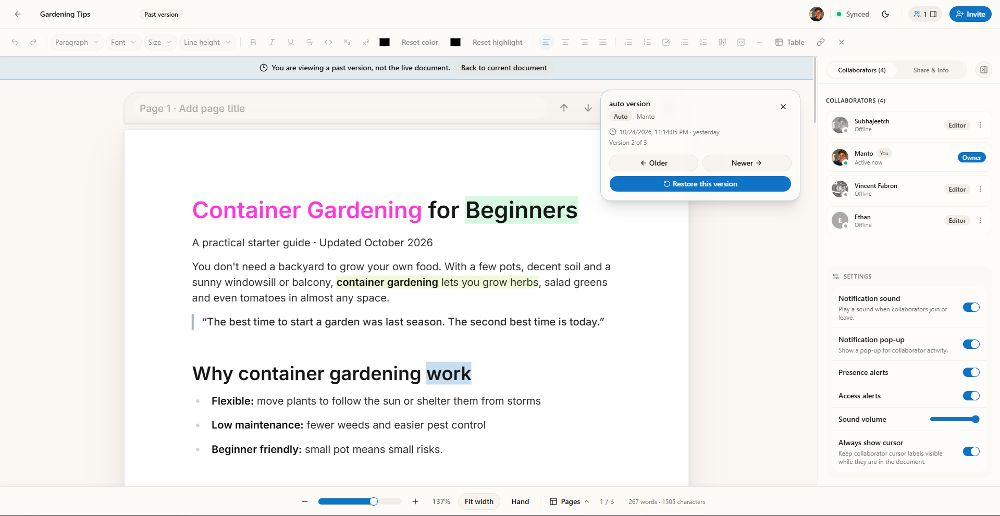
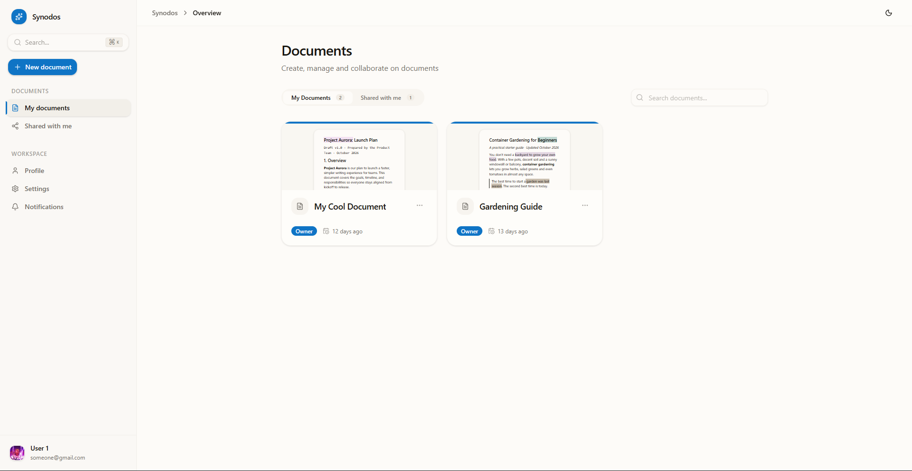

  

  
  
  
  
  
  
  
  

---

## About

Synodos is an open-source, real-time collaborative document editor for teams. It provides a fast, shared space where teammates can write, format text, and organize ideas together in the browser. Synodos is built for creators, product squads, and developers who need instant teamwork without distractions.

> **Live Demo:** [synodos.pages.dev](https://synodos.pages.dev)

### What's inside

Synodos is arranged as a monorepo (one repository holding several related apps):

- **`apps/web`**: The React user interface where you create documents and write with teammates.
- **`apps/api`**: The Fastify server that manages user accounts, permissions, and database records.
- **`apps/collab`**: The WebSocket server that broadcasts live edits and cursor positions across all active users.

---

## Demo Video

Watch the demo video to see Synodos in action:  
https://youtu.be/ausL8Qs1C-g

---

## Screenshots

<b>Click to view more screenshots</b>

 

|                      Landing Page                       |                         Document Overview                          |
| :-----------------------------------------------------: | :----------------------------------------------------------------: |
|  |  |

|                     Dark Mode Editor                     |                       Version History                       |
| :------------------------------------------------------: | :---------------------------------------------------------: |
|  |  |

|                              Dashboard                               |
| :------------------------------------------------------------------: |
|  |

---

## Getting Started

To install Synodos and run it on your computer, check out our step-by-step setup guide:

👉 **[Read the Usage Guide (docs/USAGE.md)](docs/USAGE.md)**

### App Guides

- **Web Frontend**: [apps/web README](apps/web/README.md)
- **API Backend**: `apps/api` does not have its own README yet. Everything you need to run it is covered in the [Usage Guide](docs/USAGE.md).
- **Collab Server**: `apps/collab` does not have its own README yet. Everything you need to run it is covered in the [Usage Guide](docs/USAGE.md).

---

## Contributing

We welcome contributions of all kinds, including bug fixes, design improvements, and documentation help!

Please read our **[Contributing Guide (docs/CONTRIBUTING.md)](docs/CONTRIBUTING.md)** to learn how to set up your environment, write good commit messages, and open a pull request.

---

## Support

If you find Synodos helpful or exciting, please consider giving this repository a star ⭐ on GitHub!

- Follow updates on X: [@subhajeetch](https://x.com/subhajeetch)
- Join our community on Discord: [Join Chat](https://discord.com/invite/6DhssCN2Ph)

---

## License

Synodos is free and open-source software released under the [MIT License](LICENSE).
